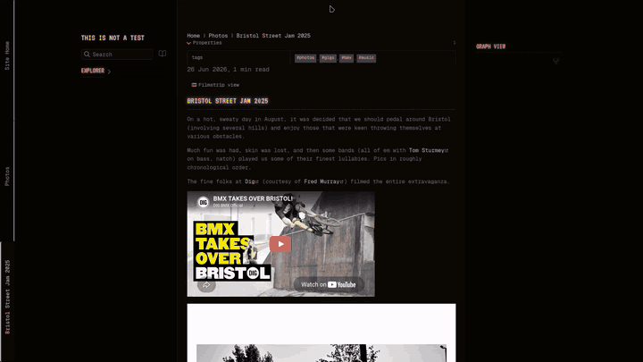

# quartz-photo-view

A [Quartz](https://quartz.jzhao.xyz) v5 plugin for pages with lots of images.

- **Lightbox** — click any image in a note to see it full size. Step through
  every image on the page with ← / →, swipe, or the on-screen arrows; Esc or a
  click closes it. Images that are links keep working as links.
- **Filmstrip view** — on pages you choose, a *Filmstrip view* button shows
  every photo at full screen height in one sideways-scrolling row. The mouse
  wheel and arrow keys scroll it; Esc closes it.

The filmstrip is **opt-in for visitors**: nothing changes until someone clicks
the button. Their choice is remembered in their own browser (they get the
filmstrip on photo pages until they close it again). Nobody else is affected.

Works with Quartz's SPA navigation. No dependencies and no build step.

<table>
  <tr>
    <th>Desktop</th>
    <th>Mobile</th>
  </tr>
  <tr>
    <td></td>
    <td></td>
  </tr>
</table>

Live on [28mm.coffee](https://28mm.coffee/photos/bristol-street-jam-2025).

## Install

```bash
npx quartz plugin add github:Doghouse-Mike/quartz-photo-view
```

or add it to `quartz.config.yaml` yourself, then `npx quartz plugin install`:

```yaml
plugins:
  - source: github:Doghouse-Mike/quartz-photo-view
    enabled: true
    order: 60
```

## Choosing which pages get the filmstrip

Add `filmstrip: true` to a note's frontmatter:

```yaml
---
title: Bristol Street Jam 2025
filmstrip: true
---
```

The button appears on that page if it has at least one image. To use a
different frontmatter key:

```yaml
    options:
      frontmatterKey: gallery
```

## Notes

- The filmstrip lazy-loads, so only the photos near the viewport are fetched.
- The lightbox's `<dialog>` approach comes from
  [vazome/quartz-image-zoom](https://github.com/vazome/quartz-image-zoom) (MIT).
  This version recreates the dialog after SPA navigation, adds prev/next, and
  skips linked images.

## Licence

MIT — see [LICENSE](LICENSE).
